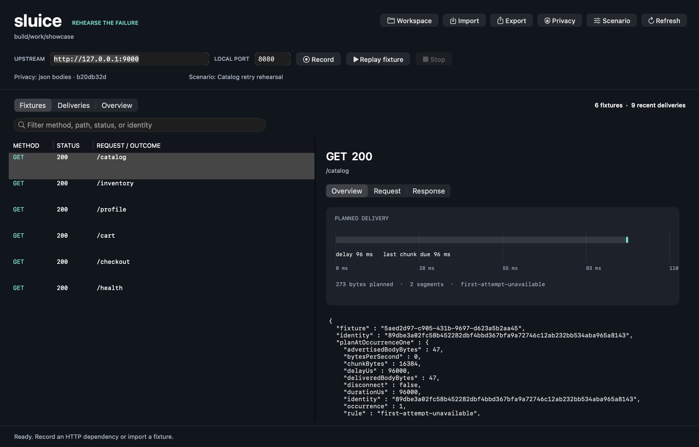

# sluice

HTTP dependency failures, rehearsed locally. Objective-C, Foundation, AppKit,
and real sockets.

Record a dependency, shut it down, and keep the client running against a local
double. Reproduce a changing response sequence, delay or truncate a body, then
inspect exactly what the socket accepted.



## Run it

macOS with Apple Command Line Tools and Python 3. No package manager, external
service, root helper, certificate installation, or Xcode project is required for
the normal build.

```sh
git clone https://github.com/Aneesh495/sluice.git
cd sluice
make
make demo
```

The demo starts a real local dependency, records six endpoints, closes the origin,
and replays the catalog with a first-attempt 503 followed by a successful response.
It checks the results and prints the workspace path. All demo data is synthetic.

```sh
make app
build/Sluice.app/Contents/MacOS/Sluice --workspace WORKSPACE_PATH \
  --privacy examples/privacy.json --scenario examples/outage.json
```

Or open `build/Sluice.app` and use Workspace to select the directory. Privacy and
Scenario load the same documents used by the CLI. The app includes searchable
fixtures, delivery receipts, request/response inspection, a planned-byte timeline,
HAR and bundle import, and fixture export.

## A dependency becomes an experiment

```sh
# Capture an HTTP dependency. Point the client at http://127.0.0.1:8080.
build/sluice record --workspace work/session --upstream http://127.0.0.1:9000 \
  --privacy examples/privacy.json

# Stop capture with Ctrl-C, then replay with the origin offline.
build/sluice replay --workspace work/session --privacy examples/privacy.json \
  --scenario examples/outage.json

build/sluice fixtures --workspace work/session
build/sluice receipts --workspace work/session
build/sluice report --workspace work/session
build/sluice check --workspace work/session
```

Recording omits bodies by default. Selecting a JSON privacy policy explicitly
permits filtered JSON capture. Offline replay serves that filtered representation;
it refuses omitted bodies and ambiguous response variants.

For an endpoint that returns `pending`, then `ready`, create a response tape from
the recording session. Tapes preserve per-request state transitions and fail
explicitly at exhaustion. They combine with fault scenarios without making
unrelated requests shift each other's counters.

## The interesting boundaries

- A strict incremental HTTP parser handles Content-Length, chunked decoding, and
  EOF framing. Ambiguous framing and unsupported upgrades fail closed.
- Privacy filtering precedes persistence. Request identity uses filtered target,
  canonical body bytes, and explicit representation headers.
- A session freezes its replay index. Exact matching refuses ambiguous fixtures,
  unsupported Vary dimensions, policy mismatches, and missing body evidence.
- Ordered fault rules use independent per-identity occurrences and
  domain-separated hash draws. No global random stream depends on other traffic.
- Delivery plans describe immutable wire bytes and arithmetic chunk due times.
  Truncation really closes before the advertised entity length is satisfied.
- A bounded nonblocking poll reactor handles partial writes, backpressure,
  half-closes, deadlines, and descriptor ownership.
- SQLite WAL transactions store immutable filtered fixtures and delivery receipts.
  Every read verifies payload hashes and reconstructed lookup metadata.
- Portable bundles validate nested checksums before atomic import. HAR 1.2 passes
  through the same privacy boundary. JSON-pointer diffs expose response changes.

A delivery receipt distinguishes planned bytes from bytes accepted by `send()`.
Transport completion does not prove that a remote application consumed the bytes
or completed its operation.

## Verify it

```sh
make test integration differential analyze
make app-smoke
make sanitize
make coverage
```

Coverage-guided fuzzing additionally needs LLVM with the libFuzzer runtime:

```sh
make fuzz FUZZ_CC="$(brew --prefix llvm)/bin/clang" FUZZ_RUNS=1000000
make acceptance
make verify
```

Normal builds use Apple's compiler. The full campaign preserves raw logs, compiler
analysis, generated-response differential checks, real-socket tests, sanitizer
runs, coverage, native rendering/lifecycle checks, and a source manifest. The
published [verification record](docs/VERIFICATION.md) states the tested boundary
and links the evidence. [The regression ledger](docs/BUGS.md) retains failures
found during development.

## Read the implementation

| Document | Focus |
| --- | --- |
| [Architecture](docs/architecture/overview.md) | Ownership, sequences, states, timing, and durability |
| [Source map](docs/architecture/source-map.md) | Entry points and extension boundaries |
| [HTTP contract](docs/PROTOCOL.md) | Framing, supported subset, normalization, and limits |
| [Scenarios and tapes](docs/SCENARIOS.md) | Matching, deterministic selection, actions, state sequences |
| [Privacy](docs/PRIVACY.md) | Filtering, identity, observable metadata, and threat boundaries |
| [Storage](docs/STORAGE.md) | Transactions, integrity, bundles, HAR, and crash behavior |
| [Developer guide](docs/DEVELOPING.md) | Build, tests, debugging, and contribution workflow |
| [Design decisions](docs/decisions/README.md) | Deliberate tradeoffs |

The deployment target is macOS 13. The normal build is native to the host
architecture. Sluice implements cleartext HTTP/1.x for a single dependency and
binds only to loopback. It buffers bounded entities and closes after one exchange.
It does not implement TLS interception, HTTP/2, WebSockets, or general forward
proxying.

MIT licensed. No vendored implementation code.
