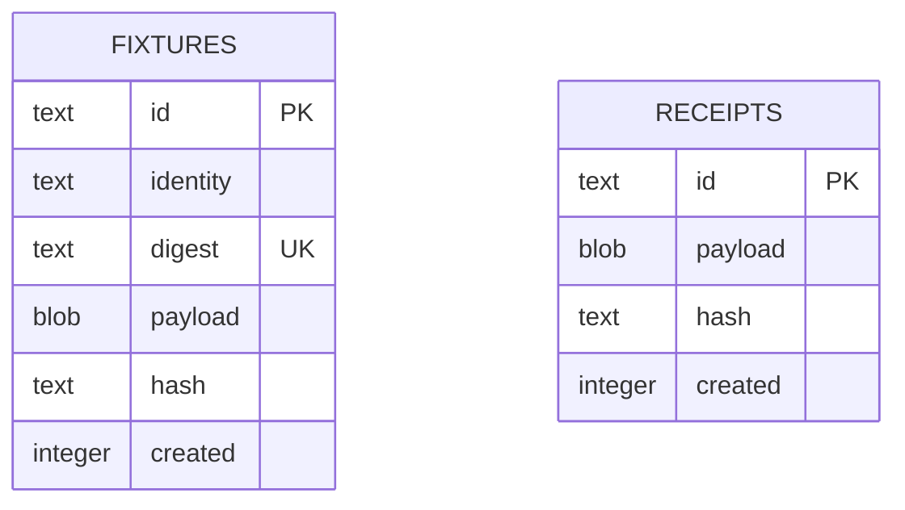

# Workspaces and portable fixtures

A workspace contains `store.sqlite3` and SQLite's normal WAL/SHM sidecars. Use the
CLI or app to inspect it; do not hand-edit lookup columns.

## Database schema



The schema version is SQLite `user_version=1`. A newer version is rejected.
Opening an existing workspace never silently downgrades its schema.

Fixtures are immutable observations. Their content digest excludes the observation
UUID and timestamp, so identical filtered captures deduplicate. Receipt fixture
references use the actual retained UUID returned by the insertion transaction.

## Transaction boundaries

- Each fixture insert is an immediate transaction.
- Each receipt insert is an independent immediate transaction.
- Bundle and HAR imports validate every fixture first, then insert all fixtures
  in one transaction. A conflicting id rolls the entire import back.
- Content duplicates return the existing id. Different content with the same id
  is a conflict, not an overwrite.

The database uses WAL, synchronous FULL, a 2 second busy timeout, and SQLite's
serialized connection mode. A store also serializes its own multi-statement
operations. New inserts fail at 10000 fixtures or 100000 receipts. SQLite page
count is capped at 262144 pages. Page byte size is SQLite's configured page size;
with the normal 4096 byte page this is about 1 GiB, excluding sidecar overhead.

The WAL supports reader/writer concurrency but only one writer at a time. It is
not a second application-level event log. See SQLite's own
[WAL documentation](https://www.sqlite.org/wal.html) for its durability and
filesystem assumptions.

## Read verification

Every fixture read verifies the SHA-256 of its serialized payload, reconstructs
and validates the immutable document, then compares its id, request identity,
and content digest with the denormalized lookup columns. Every receipt read
checks its payload hash and receipt schema.

`sluice check` runs SQLite integrity checking and these semantic checks for all
fixtures and up to the full receipt quota. A hash mismatch is an error, never a
reason to skip a row. Checksums cannot authenticate a database against an
attacker who rewrites both content and all digests.

A committed fixture can exist without a receipt if the process dies between
capture and delivery finalization. A SIGKILL integration test confirms that a
fully committed capture and receipt survive WAL recovery and can be replayed.
No claim is made that uncommitted work survives termination or hardware failure.

## Fixture document

A fixture contains version, UUID, creation time in Unix milliseconds, privacy
policy digest, request document, and response document. Messages contain ordered
headers, base64 filtered body bytes, body state, and original observed body size.
The request also contains method and target. The response contains status and
reason. An `empty` body differs from an `omitted` body.

Message projections returned to callers are copies. A caller cannot mutate a
cached target or response status while leaving its validated document and
digest unchanged.

## Bundles

```sh
build/sluice export --workspace work/session --output work/fixtures.sluice.json
build/sluice import --workspace work/another --input work/fixtures.sluice.json
```

An export optionally selects one fixture with `--fixture UUID`. The portable
format has a format label, version, payload, and payload checksum. Each payload
entry has a fixture document and a second checksum. The checksums cover canonical
sorted-key JSON as emitted by Foundation on the supported platform.

The input JSON limit is 32 MiB and the export fixture payload budget is 24 MiB.
Export large workspaces one fixture at a time. An import rejects duplicated UUIDs
inside a bundle even if the corresponding fixture documents are equal. Atomic
file publication uses an owned staging file, fsync, rename, and parent directory
synchronization.

Policies and tapes are separate explicit documents. Keep the privacy policy and
a tape alongside a bundle when they are needed to reproduce selection. A tape
references fixture UUIDs; export all referenced fixtures before moving it to a
new workspace.

## HAR 1.2

```sh
build/sluice har --workspace work/imported --input recording.har \
  --privacy examples/privacy.json
```

The importer accepts HTTP and HTTPS archive URLs because it reads an existing
archive, not encrypted live traffic. It rejects URL credentials and fragments.
Request postData needs original text; reconstructing multipart or form bodies
from parameter lists is unsupported. Response content may be text or base64.
Missing nonempty content is an error instead of an invented empty response.

HAR content text represents the decoded entity. Stale transfer and compression
headers are removed before filtering. All imported messages pass through the
same privacy policy as live capture. Import does not authenticate the archive's
source, and archive timing does not become a socket timing guarantee.
