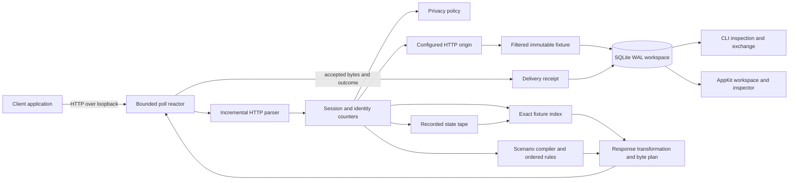
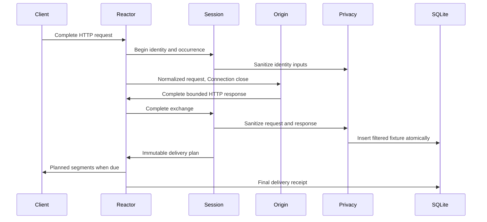
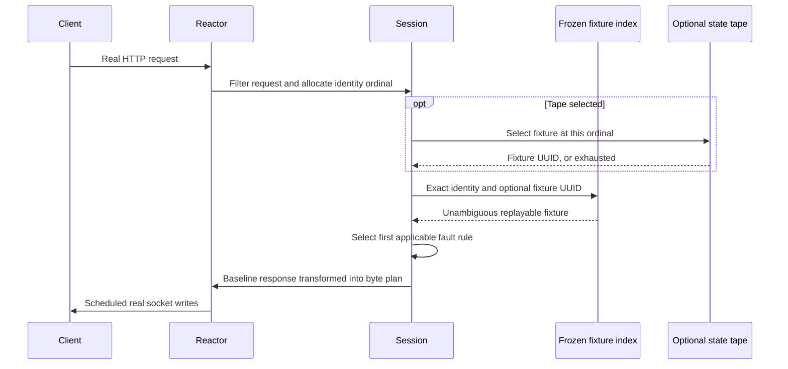
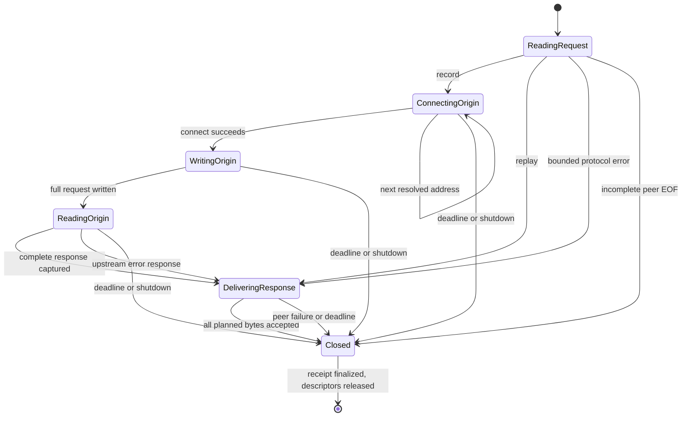

# Architecture

Sluice replaces one HTTP dependency with a controlled local endpoint. A client
keeps making real socket requests. The workbench changes the response state and
its delivery, then records what the local socket accepted.

The desktop application and command line are adapters over the same engine.
Neither has a second implementation of matching, privacy, parsing, or faults.

## Ownership boundaries

| Component | Owns | Does not own |
| --- | --- | --- |
| `SLHTTPParser` | Bounded partial head and decoded entity | Sockets or deadlines |
| `SLSession` | Identity ordinals, replay snapshot, scenario selection | Poll events |
| `SLPrivacy` | Filtering and canonical request representation | Original network writes |
| `SLStore` | One serialized SQLite connection and transactions | Raw traffic |
| `SLReplayIndex` | Frozen request-to-fixture candidates | New database observations |
| `SLTape` | Explicit fixture sequence for each identity | Wall-clock arrival order |
| `SLDeliveryPlan` | Immutable output bytes and arithmetic segment schedule | Actual socket progress |
| `SLConnection` | Client/upstream descriptors and one exchange state | Cross-thread access |
| `SLReactor` | Descriptor readiness, fairness, timeouts, final receipts | UI state |
| `SLAppController` | Main-thread controls and background work dispatch | Protocol semantics |

Connections and sessions are confined to the reactor thread. `stop` uses a
nonblocking self-pipe so the UI and signal dispatch handlers can wake the poll
loop. The UI uses a separate serial data queue. SQLite access through a store
instance is synchronized; separate store connections coordinate through WAL and
SQLite's busy timeout.

## Record an exchange

The original live request and response are forwarded, except for protocol
normalization and an explicitly selected fault. Capture filtering changes the
stored fixture, not the user's live credentials. Offline replay serves the
filtered representation. It can therefore differ intentionally from the live
response, for example a token becomes `[redacted]`.

A fixture commits before delivery starts. A receipt commits before the connection
is closed normally. These are separate observations: the origin might have
completed while the client disconnected before reading the result. A process
crash between those commits can leave a fixture with no delivery receipt.

## Offline exchange

The origin resolver and connector are never used in replay mode. A missing,
ambiguous, omitted-body, unsupported-Vary, mismatched-policy, or exhausted-tape
request produces an explicit 409 error. It does not fall back to the network.

## State machine

A client write half-close is compatible with receiving a response. After the
request has completed, the reactor uses response writes to determine whether
delivery remains possible. It does not confuse an input EOF with a full socket
failure.

## Scheduling and fairness

The poll array has room for the listener, wake pipe, and two descriptors for each
of 64 connections. Every accepted connection receives one exchange. A loop
iteration accepts at most 32 clients and writes at most 64 KiB per delivering
connection. Slow readers cannot monopolize a write loop.

Deadlines use a monotonic clock. There is a 10 second inactivity bound before
delivery, a 15 second blocked-write bound after a segment becomes due, and a 125
second total lifetime. A plan can schedule at most 120 seconds. Intentional delay
is excluded from blocked-write time.

The engine buffers a complete entity before capture and transformation. It is a
bounded dependency workbench, not an unbounded streaming proxy. The body bound is
8 MiB and the connection bound is 64. Worst-case memory includes concurrent
request, response, transformed, encoded, and fixture representations. Do not use
those maxima as a target load on a small machine.

## Durable and reproducible state

Deterministic behavior covers identity, per-identity ordinal selection, hash
sampling, response transformations, and relative segment due times. It does not
promise identical operating-system scheduling, TCP packet boundaries, elapsed
latency, or ordering among concurrent requests with the same identity.

An exact replay index is frozen at session start. New captures from another
process do not change a running replay. A state tape makes changing baseline
responses explicit and refuses gaps when constructed from a recording session.

The database stores filtered fixture documents and receipt documents with raw
payload hashes. Reads reconstruct the fixture and also verify denormalized id,
identity, and content-digest columns. Bundle checksums detect damage; they are
not signatures or proof that a sender is trustworthy.
